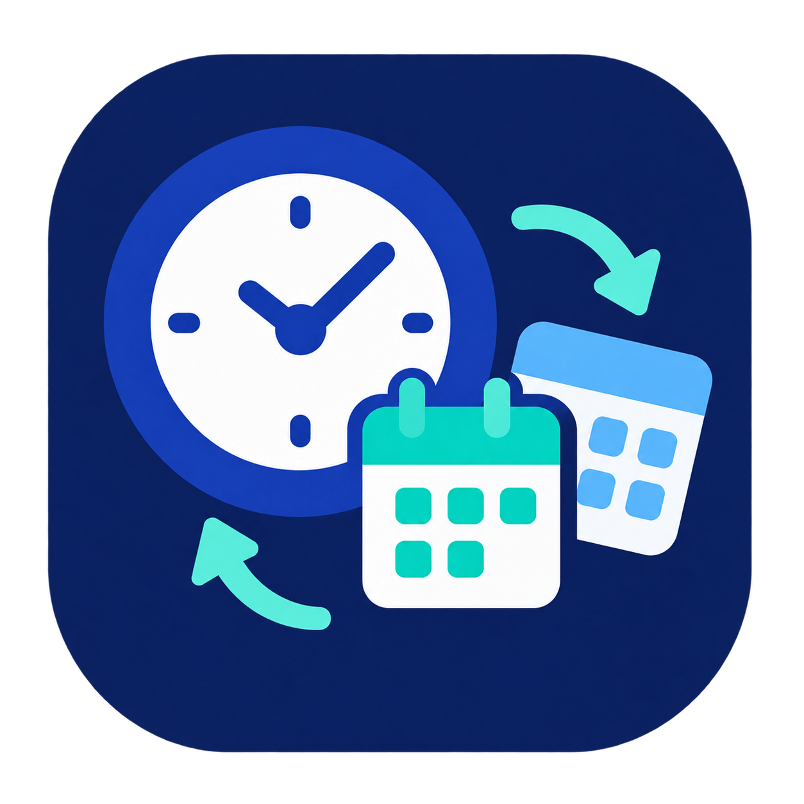
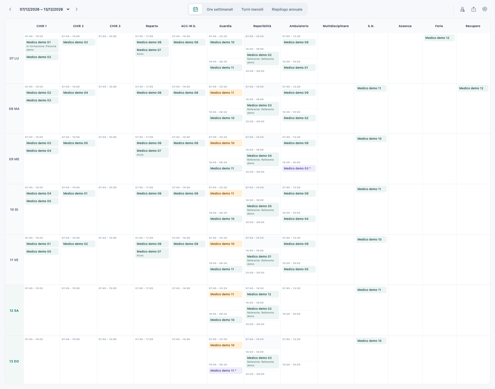

<div align="center">



# turniamo

<p>
<a href="https://github.com/antoninomariarizzo/turniamo/releases/latest/download/turniamo-Windows.exe"></a>
<a href="https://github.com/antoninomariarizzo/turniamo/releases/latest/download/turniamo-macOS-AppleSilicon.zip"></a>
</p>

<sub>🪟 Windows portable (x64) · 🍎 macOS (Apple Silicon)</sub>

</div>

[](https://www.python.org/)
[](https://github.com/antoninomariarizzo/turniamo/pulls)
[](LICENSE)

### [Descrizione in italiano](#descrizione-in-italiano) · [English Description](#english-description)

## Descrizione in italiano

turniamo è un’applicazione desktop per pianificare i turni ospedalieri, gestire le
assegnazioni dei medici e tenere sotto controllo ore, disponibilità e sovrapposizioni.
Affianca al calendario settimanale riepiloghi mensili e annuali, con esportazione in
Excel e PDF.

Disponibile per Windows e macOS, in italiano e inglese, funziona interamente offline:
i dati restano sul computer, senza account o servizi esterni.

> **ℹ️ Nota:**
> Il numero delle sale, le fasce orarie e i criteri di conteggio sono stati concordati
> per l’ospedale che utilizza il programma: non rappresentano regole generali per tutti
> gli ospedali.

[Installazione](#download-e-installazione) · [Guida rapida](#guida-rapida) ·
[Backup](#archivio-backup-e-ripristino) · [Aggiornamenti](#aggiornare-turniamo) ·
[Problemi](#problemi-e-segnalazioni) · [Sorgenti](#avvio-dai-sorgenti)

### Download e installazione

Non occorre installare Python. Scarica turniamo dai pulsanti in alto o dalla pagina
[Releases](https://github.com/antoninomariarizzo/turniamo/releases/latest).

| Pacchetto | Sistema e architettura |
| --- | --- |
| Windows | Windows 10 (1809 o successivo) / Windows 11, x64 |
| macOS | macOS 14.4 o successivo, Apple Silicon (M1 o successivi) |

Questi sono i sistemi supportati da [Qt 6.12](https://doc.qt.io/qt-6.12/supported-platforms.html),
la versione usata nell’ambiente attuale. Le verifiche automatiche del progetto usano
i runner `windows-2025` x64 e `macos-15` arm64: non coprono ogni versione minima.
Per i requisiti di uno specifico pacchetto consulta anche le sue note di release.

- **Windows (x64):** scarica `turniamo-Windows.exe` e aprilo. È un eseguibile portatile,
  senza procedura di installazione.
- **macOS (Apple Silicon, M1 o successivi):** scarica `turniamo-macOS-AppleSilicon.zip`,
  estrailo e trascina `turniamo.app` in Applicazioni. Il pacchetto non è per Mac Intel.

I pacchetti non hanno firma di distribuzione né notarizzazione: macOS e Windows
possono mostrare un avviso di sicurezza al primo avvio. Su macOS, dopo aver tentato
l’apertura, usa **Impostazioni di Sistema → Privacy e sicurezza → Apri comunque**
per autorizzare l’app scaricata da questo repository.
La [guida Apple](https://support.apple.com/it-it/102445) descrive la procedura.

Se non trova un archivio nella cartella dati selezionata, l’app ne crea uno vuoto.
Sostituire l’eseguibile o il bundle conserva l’archivio nella stessa cartella dati.
Database, backup ed esportazioni degli utenti non sono inclusi nel repository o nei download.
Su Windows, «portatile» indica che non serve un installer: i dati non vengono salvati
accanto all’eseguibile per impostazione predefinita.

#### Verificare il download

Scarica il pacchetto e `SHA256SUMS.txt` dalla **stessa release**. Prima di estrarre
lo ZIP o avviare l’eseguibile, calcola l’hash dalla cartella dei download:

macOS (Terminale):

```sh
shasum -a 256 turniamo-macOS-AppleSilicon.zip
```

Windows (PowerShell):

```powershell
Get-FileHash .\turniamo-Windows.exe -Algorithm SHA256
```

Confronta tutti i 64 caratteri con la riga dello stesso file in `SHA256SUMS.txt`
(maiuscole e minuscole sono equivalenti). Se non coincidono, riscarica il pacchetto
senza avviarlo. Il confronto verifica l’integrità rispetto al checksum della release;
non sostituisce una firma del produttore.

### Guida rapida

1. Scegli la settimana da cui iniziare nel selettore in alto a sinistra.
   Apri **Medici** dall’icona in alto a destra e inserisci i nomi del gruppo. Per
   rinominare un medico, fai clic sul nome e premi Invio oppure esci dal campo.
   Il cestino lo rimuove, insieme ai suoi incarichi, dalla settimana selezionata
   e dalle successive; lo storico precedente resta invariato.
2. Nel **Calendario**, fai clic su una cella per cercare e selezionare uno o più medici. **Conferma / Invio**
   salva le scelte; **Annulla / Esc** o un clic fuori dal menu le scarta.
   I medici indisponibili sono disabilitati e grigi; gli avvisi sono arancioni.
3. Usa il pulsante **…** accanto a un incarico per indicare pagamento, persona in
   formazione o referente. In **Reparto**, il primo medico è responsabile e i
   successivi sono aiuti; rimuovendo il responsabile, un aiuto ne assume il ruolo.
4. Consulta **Ore settimanali**, **Turni mensili** e **Riepilogo annuale** per controllare
   ore e turni. I pulsanti **i** spiegano i totali e gli incarichi che li compongono.
5. Usa l’icona **Esporta** per creare Excel o PDF.
   L’ingranaggio **Impostazioni** contiene lingua, esportazione e importazione del database.

### Anteprima



Esempio in italiano generato con un archivio in memoria e soli dati fittizi.
L’arancione segnala incarichi da controllare e permette il salvataggio; nel selettore
i medici indisponibili sono grigi e non selezionabili.

### Archivio, backup e ripristino

Le modifiche confermate sono salvate automaticamente nel database locale
`turniamo.sqlite3`, che contiene medici, settimane, incarichi e lingua.

- **macOS:** `~/Library/Application Support/turniamo/turniamo/`.
- **Windows:** cartella dati locale scelta da Qt, normalmente
  `%LOCALAPPDATA%\turniamo\turniamo\`.
- L’opzione `--data-dir` permette di scegliere una cartella diversa.

Ogni settimana conserva i propri nomi e il proprio organico. Rimozioni e rinomine
valgono dalla settimana selezionata in avanti; le settimane precedenti restano
invariate. I medici rimossi rimangono visibili nello storico con un’indicazione
discreta. I nomi devono essere univoci all’interno della settimana.

1. **Creare una copia:** apri **Impostazioni → Esporta database** e salva il file
   `.sqlite3`. La copia comprende l’intero archivio; conservane una anche su un altro dispositivo.
2. **Ripristinare o trasferire:** sul computer di destinazione apri
   **Impostazioni → Importa database**, seleziona la copia e conferma.
   L’importazione **sostituisce tutto l’archivio**, senza unire i dati.
   La lingua viene ripristinata insieme al database.
3. **Recuperare l’archivio precedente a un’importazione:** importa la copia
   `before-import-*.sqlite3` creata nella sottocartella `backups` della cartella dati.

L’app valida il database e crea una copia dell’archivio attuale prima di sostituirlo.
Crea una copia anche prima di migrare un vecchio schema; non esegue backup periodici.
Excel e PDF sono esportazioni per consultazione: **non possono essere reimportati
per ripristinare l’archivio**.

Sono importabili gli schemi database 1, 2 e 3; quelli futuri sono rifiutati.
La migrazione dallo schema 1 conserva CHIR 3 ma elimina gli incarichi della vecchia
colonna separata Aiuto reparto; gli aiuti attuali si gestiscono dentro Reparto.
L’archivio aggiornato allo schema 3 richiede turniamo v0.1.4 o successiva;
la versione dello schema è distinta da quella dell’app.

### Aggiornare turniamo

1. Esporta una copia del database da **Impostazioni → Esporta database**.
2. Chiudi l’app e scarica il nuovo pacchetto dalla pagina Releases.
3. Verifica il checksum, quindi sostituisci l’eseguibile Windows o il bundle
   `turniamo.app` in Applicazioni su macOS.
4. Riapri con lo stesso utente e la stessa cartella dati e controlla settimane e medici.

Non serve importare di nuovo il database per un normale aggiornamento. Se avevi
scelto una cartella con `--data-dir`, continua a usare quella. Prima di tornare a una
versione precedente, controlla che supporti lo schema del database aggiornato.

### Problemi e segnalazioni

- **macOS blocca il primo avvio:** segui la procedura Privacy e sicurezza descritta sopra.
- **Windows mostra un avviso:** verifica origine e checksum del download. Su computer
  gestiti dall’ospedale, un blocco delle policy va risolto con il referente informatico.
- **Archivio apparentemente vuoto dopo un aggiornamento:** controlla utente del sistema,
  cartella dati ed eventuale `--data-dir` prima di importare o sostituire file.
- **Incarico grigio o arancione:** consulta le regole sotto; il grigio nel selettore
  impedisce l’inserimento, l’arancione richiede una verifica ma permette di salvare.
- **Decimali Excel inattesi:** `6h20m` è circa `6,33 h`, non `6,20 h`.

Se il problema resta, apri una [Issue](https://github.com/antoninomariarizzo/turniamo/issues)
indicando versione di turniamo (tag del pacchetto scaricato), versione del sistema,
architettura, passaggi per riprodurlo, risultato atteso e messaggio d’errore esatto.
Usa solo nomi fittizi negli esempi e negli screenshot: non allegare database,
backup, esportazioni o dati reali dei medici.

### Regole di pianificazione e conteggio

#### Disponibilità e sovrapposizioni

- Lo stesso medico non può ricevere due volte la stessa attività nello stesso giorno.
- Gli incarichi mattutini contemporanei dello stesso medico sono segnalati in
  arancione. Questo avviso riguarda le attività coinvolte, senza estendersi
  agli incarichi pomeridiani. Multidisciplinare non partecipa a questo controllo.
- Gli avvisi arancioni permettono di salvare; le incompatibilità di disponibilità
  impediscono l’inserimento. Eventuali incompatibilità già presenti nell’archivio
  sono segnalate senza cancellare automaticamente gli incarichi.
- **Assenza, Ferie e Recupero** impediscono altri incarichi nello stesso giorno,
  inclusi Multidisciplinare e Reperibilità notturna. Non possono essere combinati
  tra loro. Il vincolo vale in entrambi gli ordini di inserimento, con l’eccezione
  dello smonto descritta sotto.
- **Reperibilità mattutina** è selezionabile soltanto il sabato.

#### Notti e smonto

- **Guardia notturna** genera automaticamente **S.N.** nel giorno successivo,
  anche tra settimane, mesi o anni diversi. Lo smonto derivato si modifica
  intervenendo sulla notte di origine.
- Il giorno di S.N. è considerato indisponibile per l’intera giornata: gli altri
  incarichi lavorativi o informativi sono segnalati in arancione, anche pomeridiani
  e notturni. La cella S.N. non riceve questo avviso per il solo fatto di essere uno
  smonto; il giorno seguente non è coinvolto.
- Se manca la notte precedente nell’archivio, è possibile inserire **S.N. manuale**.
  Inserendo poi la notte, lo smonto automatico sostituisce quello manuale nei
  conteggi, senza duplicare le ore; eredita il pagamento dalla notte di origine.
- **Recupero e S.N. sono incompatibili**, anche per uno smonto manuale: un recupero
  impedisce anche la guardia della notte precedente. Ferie e Assenza possono invece
  coesistere con S.N., che contabilizza lavoro già svolto durante la notte.
- Dopo **Reperibilità notturna**, solo gli incarichi mattutini del giorno successivo
  sono segnalati in arancione; il pomeriggio resta disponibile. Se c’è anche S.N.,
  prevale l’avviso per tutta la giornata. La reperibilità notturna non genera smonto.

#### Ore, pagamento e annotazioni

- In **Reparto**, il responsabile riceve 9h se solo, oppure 8h in presenza di aiuti;
  ciascun aiuto riceve 6h30m. ACC-W.S. è un’attività indipendente dagli aiuti di Reparto.
- Le **ore ordinarie** mostrate comprendono Ferie e Recupero. L’avviso oltre 40h
  considera lavoro ordinario e Ferie prima di sottrarre i recuperi. L’interfaccia
  non segnala i totali inferiori a 38h.
- Le **ore a pagamento** sono separate dalle ordinarie. Lo smonto di una guardia
  notturna a pagamento eredita il pagamento della notte.
- **Multidisciplinare e Reperibilità notturna** sono informative: zero ore, nessun
  pagamento e nessun contributo ai conteggi mensili o annuali. Richiedono comunque
  la presenza del medico. Assenza, Ferie e Recupero non possono essere a pagamento.
- **Referenti e persone in formazione** sono annotazioni: non ricevono ore e non
  sono soggetti ai controlli di disponibilità delle persone assegnate.
- Le fasce orarie visualizzate non determinano le ore accreditate: valgono i pesi
  della tabella seguente. I calcoli usano minuti interi, senza arrotondamenti intermedi.

#### Riepiloghi mensili e annuali

- Aprendo un riepilogo, il mese o l’anno iniziale è quello del **lunedì della
  settimana visualizzata**, non della data del computer. Il selettore del periodo
  permette poi di consultare altri mesi o anni.
- I riepiloghi consultano l’intero archivio del periodo, inclusi gli incarichi
  pianificati nel futuro e i medici rimossi ma presenti nello storico.
- **Turni mensili:** CHIR 1/2/3 contano gli incarichi di tutti i giorni. Guardia
  diurna/notturna, Reperibilità e Ambulatorio contano dal lunedì al venerdì;
  le colonne Sabato/Domenica giorno/notte contano soltanto le guardie.
  Ogni fascia AM o PM conta separatamente, anche a pagamento. Le notti contano
  nella data di inizio, senza ricontare lo smonto.
- **Festività annuali:** 25 aprile, 1 maggio, 2 giugno, 4 ottobre, 1 novembre,
  8 dicembre e 26 dicembre. Le **festività speciali** sono Capodanno, Epifania,
  Pasqua, Pasquetta, Ferragosto e Natale. Pasqua è calcolata per l’anno selezionato;
  se una data appartiene a entrambe le categorie, conta soltanto come speciale.
- Si conta una presenza per medico e giorno festivo, anche con più incarichi o
  attività a pagamento. Sono inclusi gli smonti, anche manuali e derivati da notti
  dell’anno precedente; sono esclusi Assenza, Ferie, Recupero, Multidisciplinare
  e Reperibilità notturna. Una notte può contribuire a due date festive distinte.
- **Ambulatori a pagamento:** ogni fascia AM/PM conta separatamente, anche nel
  fine settimana. **Notti a pagamento:** una per guardia, nella data di inizio,
  senza ricontare lo smonto.

#### Esportazioni

Excel e PDF includono **Calendario**, **Ore settimanali**, **Turni mensili** e
**Riepilogo annuale**, con i conteggi dell’intero periodo. Nel PDF ogni sezione
inizia su una pagina separata e può occupare più pagine.

Excel contiene inoltre un foglio tecnico nascosto che alimenta le formule delle
ore. Excel e LibreOffice le ricalcolano all’apertura; i calcoli mantengono i minuti
esatti anche quando i totali in ore sono visualizzati con due decimali.

### Peso in ore dei turni

| Attività | Ore per medico |
| --- | --- |
| CHIR 1 / CHIR 2 / CHIR 3 | 7h |
| Reparto, responsabile | 9h solo; 8h con aiuto |
| Reparto, ciascun aiuto | 6h30m |
| ACC-W.S. | 6h30m |
| Guardia diurna | 13h |
| Guardia notturna | 6h30m nella data di inizio |
| S.N., automatico o manuale | 6h30m nel giorno di smonto |
| Reperibilità mattino | 6h30m, solo sabato |
| Reperibilità pomeriggio | 4h; 3h dopo sala |
| Reperibilità notturna | 0h |
| Ambulatorio mattino | 6h |
| Ambulatorio pomeriggio | 4h30m; 4h dopo sala |
| Multidisciplinare | 0h |
| Assenza | 0h |
| Ferie | +6h20m |
| Recupero | −6h20m |

6h20m corrispondono a 380 minuti. Sala + Ambulatorio PM valgono complessivamente
11h; Sala + Reperibilità PM valgono 10h. Una Guardia notturna con il relativo S.N.
vale 13h, ripartite tra due giorni.

### Avvio dai sorgenti

Serve Python 3.11 o successivo (consigliato 3.12). I requisiti del sistema dipendono
dalla versione PySide6/Qt installata; il riferimento attuale Qt 6.12 è indicato sopra.
I pacchetti desktop scaricabili non richiedono Python.

Installa Python, poi scarica ed estrai lo
[ZIP dei sorgenti](https://github.com/antoninomariarizzo/turniamo/archive/refs/heads/main.zip)
oppure clona il repository con Git:

```sh
git clone https://github.com/antoninomariarizzo/turniamo.git
cd turniamo
```

Su macOS, dalla cartella del progetto estratto o clonato:

```sh
python3 -m venv .venv
.venv/bin/python -m pip install -e '.[dev]'
.venv/bin/python -m turniamo
```

Su Windows (PowerShell):

```powershell
py -3.12 -m venv .venv
.venv\Scripts\python -m pip install -e ".[dev]"
.venv\Scripts\python -m turniamo
```

Per gli avvii successivi basta l’ultimo comando, dalla cartella del progetto.
Per selezionare un archivio diverso, aggiungi `--data-dir` con una cartella:

macOS:

```sh
.venv/bin/python -m turniamo --data-dir /tmp/turniamo-demo
```

Windows (PowerShell):

```powershell
.venv\Scripts\python -m turniamo --data-dir "$env:TEMP\turniamo-demo"
```

L’opzione usa l’archivio nella cartella indicata e non sposta i dati esistenti.
Questi esempi usano cartelle temporanee, adatte alle prove; per dati da conservare
scegli una cartella permanente.

### Contribuire e verificare

Dopo aver installato `.[dev]`, esegui dalla radice del repository su macOS:

```sh
QT_QPA_PLATFORM=offscreen .venv/bin/python -m pytest -q
.venv/bin/python scripts/check_public_files.py
.venv/bin/python scripts/build.py
.venv/bin/python scripts/smoke_packaged.py
```

Su Windows (PowerShell):

```powershell
$env:QT_QPA_PLATFORM = "offscreen"
.venv\Scripts\python -m pytest -q
.venv\Scripts\python scripts/check_public_files.py
.venv\Scripts\python scripts/build.py
.venv\Scripts\python scripts/smoke_packaged.py
Remove-Item Env:QT_QPA_PLATFORM
```

I test usano archivi isolati; lo smoke test del pacchetto usa un database temporaneo
vuoto. Esegui il build sul sistema di destinazione: lo script non cross-compila.
Il build sostituisce gli output locali, senza pubblicare una release. La CI esegue
test, build e smoke su entrambe le piattaforme tramite il
[workflow desktop](.github/workflows/build.yml).

Mantieni le regole in Python e verifica la coerenza di UI, PDF ed Excel quando
modifichi comportamenti condivisi. Usa solo dati fittizi in test e anteprime.
Controlla ogni file prima di aggiungerlo allo staging; riesegui
`scripts/check_public_files.py` dopo aver aggiunto i nuovi file previsti, perché
controlla i percorsi tracciati. Il controllo rileva categorie note di file privati
e credenziali, ma non sostituisce la revisione dei contenuti. Nella pull request
descrivi la modifica e le verifiche pertinenti.

### Tecnologie

- **Python** per regole e calcoli.
- **SQLite** per l’archivio locale.
- **HTML, CSS e JavaScript** per l’interfaccia in una finestra desktop **Qt WebEngine**.

### Licenza

Il codice di turniamo è distribuito con licenza [BSD-3-Clause](LICENSE),
Copyright © 2026 Antonino Maria Rizzo. Le dipendenze mantengono le proprie licenze.

## English Description

turniamo is a desktop application for planning hospital shifts, managing doctor
assignments and tracking hours, availability and overlapping duties. It combines
a weekly calendar with monthly and annual summaries, with Excel and PDF exports.

Available for Windows and macOS, in Italian and English, it works entirely offline:
data stays on your computer, with no accounts or external services.

> **ℹ️ Note:**
> The number of operating rooms, time slots and counting criteria were agreed for
> the hospital using the application. They are not general rules for all hospitals.

[Installation](#download-and-installation) · [Quick start](#quick-start) ·
[Backups](#database-backup-and-restore) · [Updates](#updating-turniamo) ·
[Troubleshooting](#troubleshooting-and-reporting-issues) · [Source](#running-from-source)

### Download and installation

You do not need to install Python. Download turniamo using the buttons above or the
[Releases page](https://github.com/antoninomariarizzo/turniamo/releases/latest).

| Package | System and architecture |
| --- | --- |
| Windows | Windows 10 (1809 or later) / Windows 11, x64 |
| macOS | macOS 14.4 or later, Apple Silicon (M1 or later) |

These are the systems supported by [Qt 6.12](https://doc.qt.io/qt-6.12/supported-platforms.html),
the version used in the current development environment. Project CI checks run on
`windows-2025` x64 and `macos-15` arm64; they do not cover every minimum OS version.
Also check the release notes for the requirements of a particular package.

- **Windows (x64):** download and open `turniamo-Windows.exe`. It is a portable
  executable with no installation wizard.
- **macOS (Apple Silicon, M1 or later):** download `turniamo-macOS-AppleSilicon.zip`,
  extract it and drag `turniamo.app` into Applications. The package is not for Intel Macs.

Packages are not distribution-signed or notarized, so macOS and Windows may show a
security warning on first launch. On macOS, after attempting to open the app, use
**System Settings → Privacy & Security → Open Anyway** to allow the application
downloaded from this repository.
The [Apple guide](https://support.apple.com/en-us/102445) describes the procedure.

If no archive exists in the selected data directory, the application creates an
empty one. Replacing the executable or app bundle preserves the archive in that
same directory. User databases, backups and exports are not included in the repository
or downloads. On Windows, “portable” means no installer is required; by default,
data is stored separately from the executable.

#### Verify your download

Download the package and `SHA256SUMS.txt` from the **same release**. Before extracting
the ZIP or running the executable, calculate its hash from your download directory:

macOS (Terminal):

```sh
shasum -a 256 turniamo-macOS-AppleSilicon.zip
```

Windows (PowerShell):

```powershell
Get-FileHash .\turniamo-Windows.exe -Algorithm SHA256
```

Compare all 64 characters with the matching filename in `SHA256SUMS.txt`
(letter case does not matter). If they differ, download the package again without
running it. This checks integrity against the release checksum; it does not replace
a publisher signature.

### Quick start

1. Choose your starting week using the top-left selector.
   Open **Doctors** using the top-right icon and enter the names of your team.
   To rename a doctor, click their name and press Enter or leave the field.
   The trash button removes the doctor and their assignments from the selected
   week onwards; earlier history remains unchanged.
2. In **Calendar**, click a cell to search for and select one or more doctors. **Confirm / Enter** saves your choices;
   **Cancel / Esc** or clicking outside the picker discards them. Unavailable doctors
   are disabled and grey; warnings are orange.
3. Use **…** beside an assignment to set **Paid separately**, **In training** or **Contact**.
   In **Ward**, the first doctor is the lead and the others are assistants;
   removing the lead automatically promotes an assistant.
4. Open **Weekly hours**, **Monthly shifts** and **Annual summary** to review
   hours and shifts. The **i** buttons explain totals and their contributing assignments.
5. Use **Export** to create Excel or PDF files. The **Settings** gear contains
   language selection and database export and import.

### Preview


Italian interface example generated with an in-memory archive and fictitious data only.
Orange assignments need review and can still be saved; unavailable doctors in the
picker are grey and cannot be selected.

### Database, backup and restore

Confirmed changes are saved automatically to the local `turniamo.sqlite3` database,
which contains doctors, weeks, assignments and language settings.

- **macOS:** `~/Library/Application Support/turniamo/turniamo/`.
- **Windows:** the local data directory selected by Qt, normally
  `%LOCALAPPDATA%\turniamo\turniamo\`.
- Use `--data-dir` to select a different directory.

Each week retains its own doctor list and the names used at that time. Removing or
renaming a doctor applies from the selected week onwards; earlier weeks remain
unchanged. Removed doctors remain visible in historical schedules with a discreet
indication. Doctor names must be unique within each week.

1. **Create a backup:** open **Settings → Export database** and save the `.sqlite3`
   file. The backup contains the entire archive; keep a copy on another device too.
2. **Restore or transfer:** on the destination computer, open
   **Settings → Import database**, select the backup and confirm.
   Import **replaces the entire archive**, without merging data.
   The language setting is restored with the database.
3. **Recover the archive from before an import:** import the `before-import-*.sqlite3`
   backup created in the data directory’s `backups` subdirectory.

The app validates the incoming database and backs up the current archive before
replacement. It also creates a backup before migrating an older schema; it does
not run periodic backups. Excel and PDF are exports for viewing: **they cannot be
imported to restore the archive**.

Database schemas 1, 2 and 3 can be imported; future schemas are rejected.
Migration from schema 1 preserves SURG 3 but removes assignments from the old separate
Ward help column; current assistants are managed within Ward.
An archive upgraded to schema 3 requires turniamo v0.1.4 or later;
the schema version is separate from the application version.

### Updating turniamo

1. Export a database backup using **Settings → Export database**.
2. Close the app and download the new package from Releases.
3. Verify its checksum, then replace the Windows executable or the `turniamo.app`
   bundle in Applications on macOS.
4. Reopen with the same OS user and data directory, and check your weeks and doctors.

A normal update does not require importing the database again. If you selected a
directory with `--data-dir`, keep using it. Before reverting to an older app version,
check that it supports the upgraded database schema.

### Troubleshooting and reporting issues

- **macOS blocks first launch:** follow the Privacy & Security procedure above.
- **Windows displays a warning:** verify the download source and checksum. On a
  hospital-managed computer, ask your IT contact to resolve a policy block.
- **The archive appears empty after an update:** check the OS user, data directory
  and any `--data-dir` option before importing or replacing files.
- **A doctor or assignment is grey or orange:** consult the rules below. Grey in
  the picker prevents selection; orange requires review but allows saving.
- **Unexpected Excel decimals:** `6h20m` is approximately `6.33 h`, not `6.20 h`.

If the problem persists, open an [Issue](https://github.com/antoninomariarizzo/turniamo/issues)
with the turniamo version (the downloaded package’s release tag), OS version,
architecture, steps to reproduce, expected result and exact error message.
Use fictitious names in examples and screenshots. Do not attach databases, backups,
exports or real doctor data.

### Scheduling and counting rules

#### Availability and overlaps

- A doctor cannot receive the same activity twice on the same day.
- Concurrent morning assignments for the same doctor are highlighted in orange.
  This warning applies to the activities involved, without extending to afternoon
  assignments. Multidisciplinary assignments are excluded from this check.
- Orange warnings allow saving; availability conflicts prevent insertion.
  Existing conflicts in the archive are flagged without automatically deleting assignments.
- **Absence, Annual leave and Time off in lieu** prevent other assignments on the
  same day, including Multidisciplinary and Night on-call assignments. They cannot
  be combined with each other. These restrictions apply in either insertion order,
  with the post-night exception described below.
- **Morning on-call** is available only on Saturdays.

#### Nights and Night-off

- **Night duty** automatically generates **Night-off** (post-night entry; **S.N.** in Italian) on
  the following day, including across weeks, months and years. Edit the originating
  night duty to change its derived post-night entry.
- The entire post-night day is treated as unavailable: other work or informational
  assignments are highlighted in orange, including afternoon and night assignments.
  The post-night cell itself does not receive this warning simply for being a
  post-night entry; the day after it is unaffected.
- If the preceding night is missing from the archive, a **manual post-night entry**
  can be added. Adding the night later replaces the manual entry in calculations
  without doubling hours; the derived entry inherits the night duty’s payment status.
- **Time off in lieu and Night-off are incompatible**, including manual
  entries: time off in lieu also prevents night duty on the preceding day.
  Annual leave and Absence may coexist with a post-night entry, which accounts for
  work already performed during the night.
- After **Night on-call**, only the next day’s morning assignments receive an orange
  warning; the afternoon remains available. If actual post-night rest also applies,
  the warning covers the entire day. Night on-call does not generate post-night rest.

#### Hours, payment and annotations

- In **Ward**, the lead doctor receives 9h when alone or 8h with assistants;
  each assistant receives 6h30m. ACC-W.S. is independent of ward assistance.
- Displayed **ordinary hours** include Annual leave and Time off in lieu. The warning
  above 40h considers ordinary work and Annual leave before subtracting time off
  in lieu. The interface does not flag totals below 38h.
- **Paid hours** are separate from ordinary hours. The post-night entry of a paid
  night duty inherits the night’s payment status.
- **Multidisciplinary and Night on-call** are informational: zero hours, no payment
  and no contribution to monthly or annual counts. The doctor must still be available.
  Absence, Annual leave and Time off in lieu cannot be marked as paid.
- **Contacts and people in training** are annotations: they receive no hours and are not
  subject to the availability checks applied to assigned doctors.
- Displayed time slots do not determine credited hours: the weights in the table
  below apply. Calculations use whole minutes without intermediate rounding.

#### Monthly and annual summaries

- When opening a summary, the initial month or year is that of the **Monday of the
  displayed week**, rather than the computer’s current date. The period selector
  then allows you to view other months or years.
- Summaries use the entire archive for the period, including future assignments
  and removed doctors who appear in historical records.
- **Monthly shifts:** SURG 1/2/3 count assignments on all days. Day/night duty,
  On-call and Outpatient clinic count Monday through Friday; Saturday/Sunday
  day/night columns count only duties. Each AM or PM slot counts separately,
  including paid assignments. Nights count on their starting date, without
  counting the post-night entry again.
- **Annual holidays:** 25 April, 1 May, 2 June, 4 October, 1 November, 8 December
  and 26 December. **Special holidays:** New Year’s Day, Epiphany, Easter, Easter
  Monday, Assumption Day and Christmas. Easter is calculated for the selected year;
  a date belonging to both categories counts only as a special holiday.
- One attendance is counted per doctor per holiday, even with multiple or paid
  assignments. Post-night entries are included, including manual entries and those
  derived from nights in the previous year. Absence, Annual leave, Time off in lieu,
  Multidisciplinary and Night on-call are excluded. A night may contribute to two
  distinct holiday dates.
- **Paid outpatient clinics:** each AM/PM slot counts separately, including weekends.
  **Paid nights:** one per night duty, on its starting date, without counting the
  post-night entry again.

#### Exports

Excel and PDF include **Calendar**, **Weekly hours**, **Monthly shifts** and
**Annual summary**, with counts for the entire period. Each PDF section starts
on a separate page and may span multiple pages.

Excel also includes a hidden technical sheet supporting the hours formulas.
Excel and LibreOffice recalculate them when opening the file. Calculations retain
exact minutes even when hour totals are displayed with two decimal places.

### Credited hours per shift

| Activity | Hours per doctor |
| --- | --- |
| SURG 1 / SURG 2 / SURG 3 | 7h |
| Ward, lead | 9h alone; 8h with assistance |
| Ward, each assistant | 6h30m |
| ACC-W.S. | 6h30m |
| Day duty | 13h |
| Night duty | 6h30m on the starting date |
| Post-night entry, automatic or manual | 6h30m on the post-night day |
| Morning on-call | 6h30m, Saturdays only |
| Afternoon on-call | 4h; 3h after surgery |
| Night on-call | 0h |
| Morning outpatient clinic | 6h |
| Afternoon outpatient clinic | 4h30m; 4h after surgery |
| Multidisciplinary | 0h |
| Absence | 0h |
| Annual leave | +6h20m |
| Time off in lieu | −6h20m |

6h20m equals 380 minutes. Surgery + afternoon outpatient clinic totals 11h;
surgery + afternoon on-call totals 10h. Night duty with its post-night entry
totals 13h, split across two days.

### Running from source

Requires Python 3.11 or later (3.12 recommended). OS requirements depend on the
installed PySide6/Qt version; the current Qt 6.12 baseline is listed above.
The published desktop downloads do not require Python.

Install Python, then download and extract the repository’s
[source ZIP](https://github.com/antoninomariarizzo/turniamo/archive/refs/heads/main.zip)
or clone it with Git:

```sh
git clone https://github.com/antoninomariarizzo/turniamo.git
cd turniamo
```

On macOS, from the extracted or cloned project directory:

```sh
python3 -m venv .venv
.venv/bin/python -m pip install -e '.[dev]'
.venv/bin/python -m turniamo
```

On Windows (PowerShell):

```powershell
py -3.12 -m venv .venv
.venv\Scripts\python -m pip install -e ".[dev]"
.venv\Scripts\python -m turniamo
```

For subsequent launches, run only the last command from the project directory.
The data directory is separate from the application. To select a different archive,
append `--data-dir /path/to/archive`, for example:

```sh
.venv/bin/python -m turniamo --data-dir /tmp/turniamo-demo
```

This uses the archive in the specified directory; it does not move your existing data.

Windows equivalent (PowerShell):

```powershell
.venv\Scripts\python -m turniamo --data-dir "$env:TEMP\turniamo-demo"
```

These examples use temporary directories suitable for testing; choose a permanent
directory for data you intend to keep.

### Contributing and checks

After installing `.[dev]`, run these commands from the repository root on macOS:

```sh
QT_QPA_PLATFORM=offscreen .venv/bin/python -m pytest -q
.venv/bin/python scripts/check_public_files.py
.venv/bin/python scripts/build.py
.venv/bin/python scripts/smoke_packaged.py
```

On Windows (PowerShell):

```powershell
$env:QT_QPA_PLATFORM = "offscreen"
.venv\Scripts\python -m pytest -q
.venv\Scripts\python scripts/check_public_files.py
.venv\Scripts\python scripts/build.py
.venv\Scripts\python scripts/smoke_packaged.py
Remove-Item Env:QT_QPA_PLATFORM
```

Tests use isolated archives; the packaged smoke check uses a temporary empty database.
Build on the target OS: the build script does not cross-compile. Building replaces
local build outputs, but does not publish a release. CI runs tests, build and smoke
checks for both platforms through the
[desktop workflow](.github/workflows/build.yml).

Keep scheduling rules in Python and check UI, PDF and Excel consistency when changing
shared behavior. Use only synthetic data in tests and previews. Review each file
before staging it; rerun `scripts/check_public_files.py` after staging intended new
files, since it checks tracked paths. It detects known private-file categories and
credential patterns, but does not replace a content review. Describe the change and
relevant checks in your pull request.

### Tech Stack

- **Python** for scheduling rules and calculations.
- **SQLite** for local storage.
- **HTML, CSS and JavaScript** for the interface, hosted in a **Qt WebEngine** desktop window.

### License

turniamo’s code is distributed under the [BSD-3-Clause license](LICENSE),
Copyright © 2026 Antonino Maria Rizzo. Dependencies retain their own licenses.
